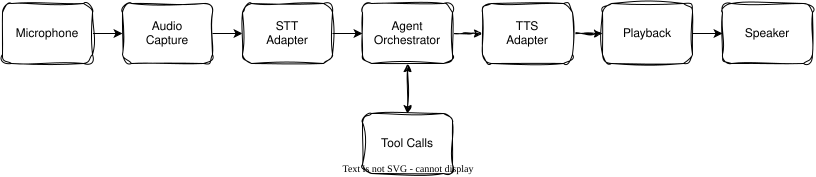

# Voice Agent (_Restaurant_)

Build in different milestones, not all at once. Each one delivers something independently testable before moving to the next.

## Phase 1-2: Synchronous flow

One bounded exchange at a time: record a complete utterance, process it, speak the response, then wait for the next one. Streaming in milestone 2 makes that single exchange feel faster, it does not change the turn-based shape.

### 01. A synchronous voice assistant

feat: Voice Agent in a complete synchronous flow that record the utterance, transcribe, send to the LLM, synthe
- [x] Record a complete utterance
- [x] Transcribe it
- [x] Send the transcript to the LLM which will be able to call some tools
- [x] Synthesize the response
- [x] Play it

Learn: model APIs, audio formats, input/output contracts.

### 02. Streaming LLM output and TTS

- [x] Generate response text incrementally
- [x] Synthesize complete sentences or suitable chunks as they become available

Learn: async generators, buffering, chunk boundaries, latency.

## Phase 3-5: Continuous, real-time flow

A genuinely different architecture, not just a faster version of phase 1-2: audio is captured continuously instead of push-to-talk, VAD decides where a turn starts and ends instead of a button, the user can interrupt mid-response, and the LLM's output streams straight through to audio instead of waiting for a complete reply.

### 03. Continuous audio and VAD

- [ ] Keep capturing microphone audio
- [ ] Detect speech segments
- [ ] Establish turn boundaries automatically

Learn: audio frames, VAD, partial transcripts, buffering.

### 04. Interruptions and cancellation

- [ ] Let the user interrupt playback
- [ ] Cancel obsolete generation tasks
- [ ] Prevent old audio from leaking into the next turn

Learn: task lifecycles, cancellation, concurrency, race conditions.

### 05. Measure and improve

- [ ] Measure end-of-speech-to-first-audio latency
- [ ] Measure transcription quality
- [ ] Measure model speed
- [ ] Measure interruption response time
- [ ] Add structured logs
- [ ] Add automated tests

Learn: observability, profiling, latency budgets, reliability.

See `DESIGN.md` for the rationale and decisions behind these milestones.
